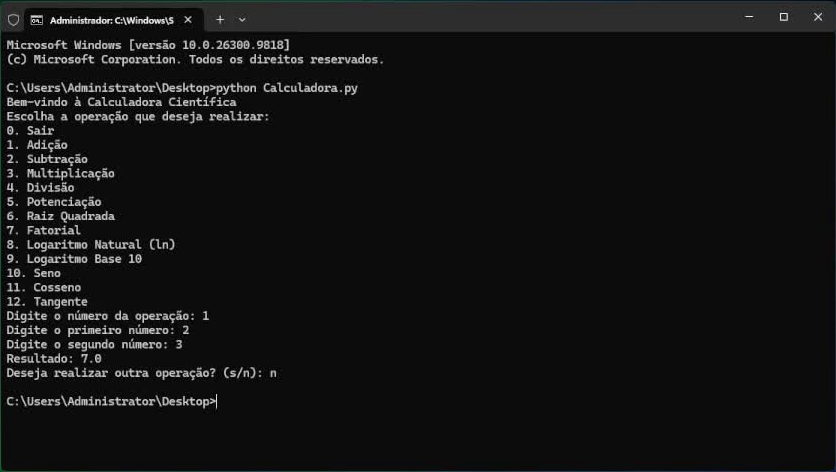

# Relatório de Bugs — Calculadora Científica

**Arquivo analisado:** `Calculadora.py` (versão original fornecida na atividade)
**Responsável pela análise:** Victor Conceição
**Data de identificação (todos):** 09/11/2026

## Ambiente de teste (vale para todos os bugs)

| Item | Versão |
|------|--------|
| Sistema operacional | Windows 11 Pro |
| Python | 3.11.4 |
| NumPy | 2.4.6 |
| Git | 2.55.0 |
| Terminal | Git Bash / PowerShell |

### Como reproduzi os bugs

Rodei a calculadora pelo terminal (`python Calculadora.py`), escolhendo cada opção do menu e digitando os valores. Em cada bug abaixo colei o trecho da saída do terminal. Para o Bug #1, que escolhi para o TDD, também gravei um vídeo e tirei um print (pasta [`evidencias/`](evidencias/)).

## Resumo

| # | Título | Localização | Severidade | Status |
|---|--------|-------------|-----------|--------|
| 1 | Adição soma o primeiro número duas vezes | `adicao()`, linha 4 | Alta | Resolvido |
| 2 | Divisão por zero derruba o programa | `divisao()`, linha 13 | Alta | Não resolvido |
| 3 | Fatorial sempre retorna 0 (e aceita negativo) | `fatorial()`, linhas 23-27 | Alta | Não resolvido |
| 4 | Logaritmo natural usa função inexistente `np.ln` | `logaritmo_natural()`, linha 32 | Crítica | Não resolvido |
| 5 | Logaritmo base 10 calcula ln e aceita zero | `logaritmo_base10()`, linhas 35-37 | Alta | Não resolvido |
| 6 | Opção "10. Seno" aparece no menu mas não existe | `menu()` linha 52 / `calculadora_cientifica()` | Média | Não resolvido |
| 7 | Função `cosseno` não está definida | `calculadora_cientifica()`, linha 95 | Crítica | Não resolvido |
| 8 | Função `tangente` não está definida | `calculadora_cientifica()`, linha 99 | Crítica | Não resolvido |
| 9 | Entrada não numérica derruba o programa | `calculadora_cientifica()`, linhas 64-90 | Média | Não resolvido |

---

## Bug #1: Adição soma o primeiro número duas vezes

### Identificação
- **Título:** A função de adição retorna `2x + y` em vez de `x + y`
- **Localização:** `Calculadora.py`, função `adicao(x, y)`, linha 4

### Descrição detalhada
A função faz `return x + np.add(x, y)`. Como `np.add(x, y)` já é `x + y`, o resultado final fica `x + (x + y)`, ou seja, o primeiro número é somado duas vezes. É a operação mais básica da calculadora, e ela dá resultado errado para qualquer valor de `x` diferente de zero. O pior é que não aparece erro nenhum: o usuário recebe um número errado achando que está certo.

**Contexto:** ambiente padrão (tabela acima). Acontece pela opção 1 do menu e também chamando a função direto.

### Passos para reproduzir
1. Rodar `python Calculadora.py`
2. Digitar `1` (Adição)
3. Primeiro número: `2`
4. Segundo número: `3`

**Consistência:** acontece sempre (100%), para qualquer `x ≠ 0`.

### Resultado esperado vs. obtido
- **Esperado:** `Resultado: 5.0`
- **Obtido:** `Resultado: 7.0`

### Evidências
```
Digite o número da operação: 1
Digite o primeiro número: 2
Digite o segundo número: 3
Resultado: 7.0
```

**Print da execução pelo menu** (`python Calculadora.py` → opção `1`, números `2` e `3`):



**Vídeo:** [evidencias/bug1_adicao.mp4](evidencias/bug1_adicao.mp4), com a calculadora original rodando no terminal do Windows e mostrando `Resultado: 7.0` para 2 + 3.

### Severidade e impacto
- **Severidade:** Alta
- **Impacto:** qualquer soma feita na calculadora sai errada sem aviso. Não trava o programa, mas o resultado incorreto é pior que um erro visível, porque o usuário pode confiar nele.

### Sugestão de correção
Trocar por `return np.add(x, y)` ou simplesmente `return x + y`.

### Registro
- **Data:** 09/11/2026
- **Status:** Resolvido em 09/11/2026 (corrigido com TDD)

### Correção aplicada

**O que foi alterado:** só a função `adicao` em `Calculadora.py`.

```python
# antes (com bug)
def adicao(x, y):
    return x + np.add(x, y)

# depois
def adicao(x, y):
    """Retorna a soma de x e y."""
    return x + y
```

**Por que foi alterado:** o `x` era somado duas vezes, uma no `x +` e outra dentro do `np.add(x, y)`. Remover a soma extra resolve o problema.

**Como foi feito (TDD):**
1. **Vermelho:** escrevi 7 testes em `TestAdicao` (`test_calculadora.py`) com o resultado esperado. Rodei com o código ainda com o bug e os 7 falharam ([evidencias/tdd_vermelho.txt](evidencias/tdd_vermelho.txt)).
2. **Verde:** fiz a correção mínima `return np.add(x, y)`. Os 7 testes passaram ([evidencias/tdd_verde.txt](evidencias/tdd_verde.txt)).
3. **Refatoração:** troquei por `return x + y`, que é mais simples, segue o mesmo padrão da `subtracao` e devolve `float` comum em vez de `np.float64`. Adicionei um teste para o tipo do retorno e testes de regressão para as outras operações básicas. Ficaram 13 de 13 passando ([evidencias/tdd_refatoracao.txt](evidencias/tdd_refatoracao.txt)).

**Como isso resolve o bug:** `adicao(2, 3)` agora retorna `5`. Pelo menu (opção 1, números 2 e 3) aparece `Resultado: 5.0`. Os testes de regressão mostram que subtração, multiplicação, divisão, potência e raiz continuam funcionando como antes, ou seja, a correção não introduziu bugs novos.

---

## Bug #2: Divisão por zero derruba o programa

### Identificação
- **Título:** Dividir por zero gera `ZeroDivisionError` e encerra a calculadora
- **Localização:** `Calculadora.py`, função `divisao(x, y)`, linha 13

### Descrição detalhada
A função faz `return x / y` sem verificar se `y` é zero. Como o menu converte as entradas para `float`, a divisão por `0.0` lança `ZeroDivisionError`. Ninguém trata a exceção, então o programa fecha com traceback. Outras funções (raiz, log) têm verificação de entrada inválida; a divisão não tem.

**Contexto:** ambiente padrão. Entradas `float` do Python puro (não NumPy).

### Passos para reproduzir
1. Rodar `python Calculadora.py`
2. Digitar `4` (Divisão)
3. Primeiro número: `10`
4. Segundo número: `0`

**Consistência:** sempre que o divisor é zero.

### Resultado esperado vs. obtido
- **Esperado:** mensagem amigável como `Erro: Divisão por zero` e o programa continuar.
- **Obtido:** o programa fecha com `ZeroDivisionError: float division by zero`.

### Evidências
```
Digite o número da operação: 4
Digite o primeiro número: 10
Digite o segundo número: 0
Traceback (most recent call last):
  ...
  File "C:\Users\Administrator\Documents\bug-hunter-tdd-calculator\Calculadora.py", line 13, in divisao
    return x / y
ZeroDivisionError: float division by zero
```

### Severidade e impacto
- **Severidade:** Alta
- **Impacto:** um erro comum do usuário fecha a aplicação inteira.

### Registro
- **Data:** 09/11/2026
- **Status:** Não resolvido

---

## Bug #3: Fatorial sempre retorna 0 (e aceita número negativo)

### Identificação
- **Título:** `fatorial()` multiplica por 0 na primeira iteração
- **Localização:** `Calculadora.py`, função `fatorial(x)`, linhas 23-27

### Descrição detalhada
O laço é `for i in range(x+1)`, que começa em `i = 0`. Na primeira volta `fat *= 0` e daí em diante o resultado fica sempre 0. Além disso, para número negativo o `range` fica vazio e a função retorna `1`, o que também está errado (fatorial de negativo não é definido).

**Contexto:** ambiente padrão. O menu converte a entrada com `int()`.

### Passos para reproduzir
1. Rodar `python Calculadora.py`
2. Digitar `7` (Fatorial)
3. Número: `5`

**Consistência:** sempre, para qualquer `x ≥ 1`. Para `x = 0` o resultado (`0`) também está errado, já que `0! = 1`.

### Resultado esperado vs. obtido
- **Esperado:** `5! = 120`; `0! = 1`; negativo: mensagem de erro.
- **Obtido:** `0` para `x ≥ 0`; `1` para negativos.

### Evidências
```
Digite o número da operação: 7
Digite o número: 5
Resultado: 0

Digite o número da operação: 7
Digite o número: -3
Resultado: 1
```

### Severidade e impacto
- **Severidade:** Alta
- **Impacto:** a operação de fatorial não funciona para nenhum valor.

### Sugestão de correção
Usar `range(1, x + 1)` e validar `x < 0` (ou usar `math.factorial`).

### Registro
- **Data:** 09/11/2026
- **Status:** Não resolvido

---

## Bug #4: Logaritmo natural usa função inexistente `np.ln`

### Identificação
- **Título:** `logaritmo_natural()` lança `AttributeError`
- **Localização:** `Calculadora.py`, função `logaritmo_natural(x)`, linha 32

### Descrição detalhada
O NumPy não tem a função `ln`. O logaritmo natural no NumPy é `np.log`. Qualquer valor positivo passa pela validação e cai em `np.ln(x)`, que gera `AttributeError` e fecha o programa.

**Contexto:** NumPy 2.4.6 (a função `ln` não existe em nenhuma versão do NumPy).

### Passos para reproduzir
1. Rodar `python Calculadora.py`
2. Digitar `8` (Logaritmo Natural)
3. Número: `10`

**Consistência:** sempre, para qualquer `x > 0`.

### Resultado esperado vs. obtido
- **Esperado:** `Resultado: 2.302585092994046`
- **Obtido:** `AttributeError: module 'numpy' has no attribute 'ln'`

### Evidências
```
Digite o número da operação: 8
Digite o número: 10
Traceback (most recent call last):
  ...
  File "C:\Users\Administrator\Documents\bug-hunter-tdd-calculator\Calculadora.py", line 32, in logaritmo_natural
    return np.ln(x)
AttributeError: module 'numpy' has no attribute 'ln'
```

### Severidade e impacto
- **Severidade:** Crítica
- **Impacto:** a funcionalidade não funciona em nenhum caso válido e ainda derruba o programa.

### Sugestão de correção
Trocar `np.ln(x)` por `np.log(x)`.

### Registro
- **Data:** 09/11/2026
- **Status:** Não resolvido

---

## Bug #5: Logaritmo base 10 calcula ln e aceita zero

### Identificação
- **Título:** `logaritmo_base10()` usa `np.log` (base e) e a validação deixa passar o 0
- **Localização:** `Calculadora.py`, função `logaritmo_base10(x)`, linhas 34-37

### Descrição detalhada
São dois problemas na mesma função:
1. Usa `np.log(x)`, que é o logaritmo **natural**, e não `np.log10(x)`. O resultado sai na base errada.
2. A condição é `if x < 0`, mas o log de 0 também não existe. Com `x = 0` a função devolve `-inf` e o NumPy mostra um `RuntimeWarning`. A própria mensagem diz "número não positivo", então a intenção era `x <= 0`.

**Contexto:** ambiente padrão.

### Passos para reproduzir
1. Rodar `python Calculadora.py`
2. Digitar `9` (Logaritmo Base 10)
3. Número: `100` (e repetir com `0`)

**Consistência:** sempre.

### Resultado esperado vs. obtido
- **Esperado:** `log10(100) = 2.0`; para `0`, mensagem de erro.
- **Obtido:** `4.605170185988092` (que é ln 100); para `0`, `-inf` com warning.

### Evidências
```
Digite o número da operação: 9
Digite o número: 100
Resultado: 4.605170185988092

Digite o número da operação: 9
Digite o número: 0
C:\Users\Administrator\Documents\bug-hunter-tdd-calculator\Calculadora.py:37: RuntimeWarning: divide by zero encountered in log
  return np.log(x)
Resultado: -inf
```

### Severidade e impacto
- **Severidade:** Alta
- **Impacto:** resultado matematicamente errado sem aviso ao usuário.

### Registro
- **Data:** 09/11/2026
- **Status:** Não resolvido

---

## Bug #6: Opção "10. Seno" aparece no menu mas não existe

### Identificação
- **Título:** Menu oferece Seno, mas a opção cai em "Operação inválida"
- **Localização:** `Calculadora.py`, `menu()` linha 52 e `calculadora_cientifica()` (falta o `elif escolha == '10'`)

### Descrição detalhada
O menu mostra `10. Seno`, mas `calculadora_cientifica()` não tem tratamento para `'10'` e não existe função `seno`. O usuário escolhe uma opção que está na tela e recebe "Operação inválida".

**Contexto:** ambiente padrão.

### Passos para reproduzir
1. Rodar `python Calculadora.py`
2. Digitar `10`

**Consistência:** sempre.

### Resultado esperado vs. obtido
- **Esperado:** pedir o ângulo e mostrar o seno.
- **Obtido:** `Operação inválida. Tente novamente.`

### Evidências
```
Digite o número da operação: 10
Operação inválida. Tente novamente.
```

### Severidade e impacto
- **Severidade:** Média
- **Impacto:** uma funcionalidade anunciada não existe. Não trava, mas confunde o usuário.

### Registro
- **Data:** 09/11/2026
- **Status:** Não resolvido

---

## Bug #7: Função `cosseno` não está definida

### Identificação
- **Título:** Escolher Cosseno gera `NameError`
- **Localização:** `Calculadora.py`, `calculadora_cientifica()`, linha 95

### Descrição detalhada
A opção 11 chama `cosseno(x)`, mas essa função não existe no arquivo. O Python lança `NameError` e o programa fecha, depois de já ter pedido o ângulo ao usuário.

**Contexto:** ambiente padrão.

### Passos para reproduzir
1. Rodar `python Calculadora.py`
2. Digitar `11`
3. Ângulo: `60`

**Consistência:** sempre.

### Resultado esperado vs. obtido
- **Esperado:** `Resultado: 0.5` (aprox.)
- **Obtido:** `NameError: name 'cosseno' is not defined`

### Evidências
```
Digite o número da operação: 11
Digite o ângulo em graus: 60
Traceback (most recent call last):
  ...
  File "C:\Users\Administrator\Documents\bug-hunter-tdd-calculator\Calculadora.py", line 95, in calculadora_cientifica
    print("Resultado:", cosseno(x))
NameError: name 'cosseno' is not defined
```

### Severidade e impacto
- **Severidade:** Crítica
- **Impacto:** a opção sempre derruba o programa.

### Sugestão de correção
Implementar `def cosseno(x, radianos=False)` com `np.cos`, convertendo graus para radianos.

### Registro
- **Data:** 09/11/2026
- **Status:** Não resolvido

---

## Bug #8: Função `tangente` não está definida

### Identificação
- **Título:** Escolher Tangente gera `NameError`
- **Localização:** `Calculadora.py`, `calculadora_cientifica()`, linha 99

### Descrição detalhada
Mesmo problema do Bug #7: a opção 12 chama `tangente(x, radianos=False)`, mas a função nunca foi escrita. Pela chamada dá para perceber que a ideia era ter um parâmetro `radianos`.

**Contexto:** ambiente padrão.

### Passos para reproduzir
1. Rodar `python Calculadora.py`
2. Digitar `12`
3. Ângulo: `45`

**Consistência:** sempre.

### Resultado esperado vs. obtido
- **Esperado:** `Resultado: 1.0` (aprox.)
- **Obtido:** `NameError: name 'tangente' is not defined`

### Evidências
```
Digite o número da operação: 12
Digite o ângulo em graus: 45
Traceback (most recent call last):
  ...
  File "C:\Users\Administrator\Documents\bug-hunter-tdd-calculator\Calculadora.py", line 99, in calculadora_cientifica
    print("Resultado:", tangente(x, radianos=False))
NameError: name 'tangente' is not defined
```

### Severidade e impacto
- **Severidade:** Crítica
- **Impacto:** a opção sempre derruba o programa.

### Registro
- **Data:** 09/11/2026
- **Status:** Não resolvido

---

## Bug #9: Entrada não numérica derruba o programa

### Identificação
- **Título:** Digitar texto no lugar de número gera `ValueError` não tratado
- **Localização:** `Calculadora.py`, `calculadora_cientifica()`, linhas 64-90 (todos os `float(input(...))` e `int(input(...))`)

### Descrição detalhada
As entradas são convertidas direto com `float()`/`int()` sem `try/except`. Se o usuário digitar uma letra ou deixar vazio, o programa fecha com `ValueError`. No fatorial, digitar um decimal como `5.5` também quebra por causa do `int()`.

**Contexto:** ambiente padrão.

### Passos para reproduzir
1. Rodar `python Calculadora.py`
2. Digitar `1`
3. Primeiro número: `abc`

**Consistência:** sempre.

### Resultado esperado vs. obtido
- **Esperado:** mensagem "Entrada inválida, digite um número" e pedir de novo.
- **Obtido:** `ValueError: could not convert string to float: 'abc'`

### Evidências
```
Digite o número da operação: 1
Digite o primeiro número: abc
Traceback (most recent call last):
  ...
  File "C:\Users\Administrator\Documents\bug-hunter-tdd-calculator\Calculadora.py", line 64, in calculadora_cientifica
    x = float(input("Digite o primeiro número: "))
ValueError: could not convert string to float: 'abc'
```

### Severidade e impacto
- **Severidade:** Média
- **Impacto:** qualquer erro de digitação fecha a calculadora.

### Registro
- **Data:** 09/11/2026
- **Status:** Não resolvido
